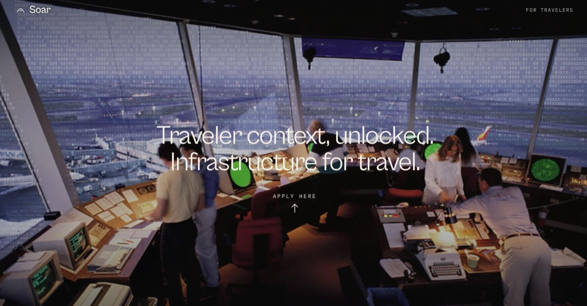
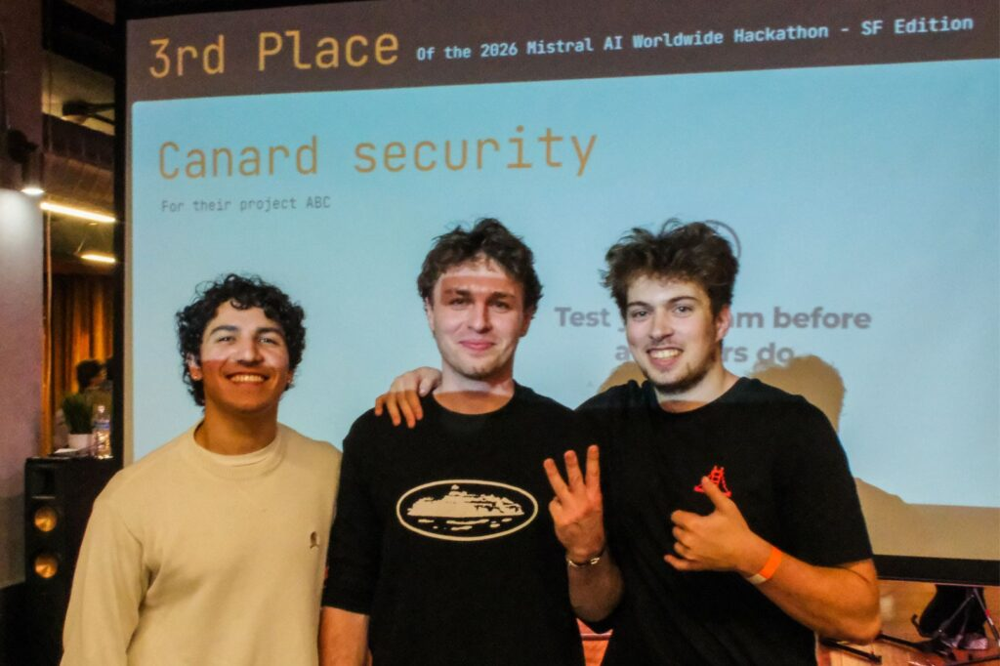

<h1 align="left">Ivan Severinov</h1>

  <b>AI engineer in private markets &amp; startups.</b> I build AI for operations, growth and the wider business: agent systems that run real workflows end to end, growth engines that find and win customers, and research tools that help teams decide faster.

  

  
  
  
   
  
  
  
  
  
  
  
  
  
   
  
  
  
  
  
  
  
  
  

<!--
  TODO(Ivan): replace this comment with 2–3 lines on what you're working on right now.
  HTML comments don't render on GitHub, so this stays hidden until you fill it in.
-->

### What I work on

- **AI for operations**: agents that take back-office work from request to done (intake, approvals, bookings, reconciliation), with people in the loop where it matters
- **Growth engineering**: AI-driven pipelines that source, enrich and match prospects, then power outreach and track what converts
- **AI for business & investment teams**: research, diligence and decision-support copilots grounded in a company's own data, filings and data rooms
- **AI brains & operating systems**: shared memory, orchestration, tools and guardrails, so many agents work as one system
- **Retrieval & context graphs**: agentic RAG across documents and live sources, plus knowledge graphs that give each agent exactly the context it needs

### Selected work

**Soar** · 🥈 2nd place, OpenAI hackathon · private 
AI operating system for business travel: links Slack, calendar, CRM and finance into a context graph, then plans, approves, books and expenses each trip.

**[Canard Security](https://github.com/yoitsmeivn/MistralAIHackathon)** · 🥉 3rd of ~70 teams, Mistral AI Worldwide Hackathon (SF) 
Voice-phishing simulation: an AI agent calls employees as an exec or IT support and adapts live, exposing social-engineering risk before attackers do.

**[Multi-View Industrial Clustering](https://github.com/yoitsmeivn/Multi-View-Industrial-Clustering-Semantic-Labeling-Pipeline)** 
Sorts UK companies into a three-level sector taxonomy using six embedding views, spectral clustering built from scratch, and LLM-named clusters.

**[Chinook Support Agent (LangChain + LangSmith)](https://github.com/yoitsmeivn/LangChain-Demo)** 
Production-style support agent on LangGraph and Claude, with injection guards, human approval for refunds, and LangSmith tracing and evals.

**[agentplan](https://github.com/yoitsmeivn/Snowflake-Agent-Token-Hackathon)** · Snowflake × Beta Fund × Evermind agent & token economy hackathon 
Cuts coding-agent costs: Claude Code plans and delegates simple subtasks to cheaper models (Codex, local Qwen3-4B), with live savings tracking.

Also: ML coursework from Imperial College London ([neural networks](https://github.com/yoitsmeivn/Artifical-Neural-Networks), [maths for ML](https://github.com/yoitsmeivn/Kryptonite-N)) and hackathon builds with H Company and YC.

### Activity

  

### Hackathon wins

<table>
  <tr>
    <td width="50%" valign="top">
      <b>🥈 2nd place · OpenAI hackathon</b> 
      Soar: infrastructure for business travel  
      
    </td>
    <td width="50%" valign="top">
      <b>🥉 3rd place · Mistral AI Worldwide Hackathon</b> 
      Canard Security · <a href="https://news.ucsc.edu/2026/03/ucsc-trio-takes-third-at-2026-mistral-ai-hackathon-with-cybersecurity-platform/">UC Santa Cruz News coverage</a>  
      
    </td>
  </tr>
</table>

Most of my work lives in private repositories. It counts toward the calendar above, but repository names never appear.
